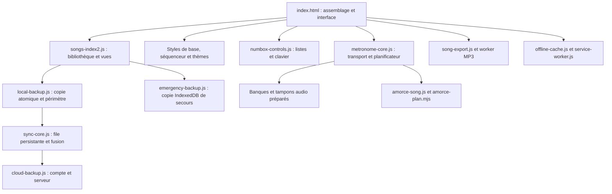

# Architecture

Le site reste une application statique. L’extraction conserve des scripts classiques et leur ordre : elle ne convertit pas le moteur audio en modules ES et n’altère pas les sons approuvés.

## Moteur et interface

`metronome-core.js` contient les fonctions historiques de transport, le planificateur et les références musicales partagées. Les variables lexicales globales restent un contrat existant avec les modules. Ne pas déplacer une fonction de rendu sans comparer le PCM.

`numbox-controls.js` ne connaît ni le stockage ni l’audio. `compact-controls.js` dimensionne les listes ; `training-numbox.js` garde la liste virtuelle des grandes plages. Le nom accessible inclut le contexte et la valeur visible. Les cartes contenant des commandes sont des groupes et non des boutons imbriqués.

`settings-accessibility.js` fournit les rôles du panneau Préférences, la limitation du focus, Échap, le retour du focus et l’inertie du fond. `workspace-layout.js` conserve la navigation et le placement. Les raccourcis globaux sont suspendus dans les dialogues.

`app-base.css`, `sequencer-layout.css` et `appearance-theme.css` sont extraits à leur position initiale dans la cascade. `accessibility.css` regroupe le focus visible, les contrastes mesurés et le retour d’erreur. Les fichiers historiques de thèmes demeurent nécessaires ; les supprimer sans comparaison changerait le rendu.

## Données

La bibliothèque est le modèle en mémoire. Le stockage principal conserve ensemble la bibliothèque, les révisions et la file d’attente. L’écriture compare la chaîne brute précédente : un onglet périmé ne remplace pas une nouvelle copie. Une source illisible passe en lecture seule.

Le délai de 400 ms concerne les frappes, pas les autres mutations. `flushPending()` échoue tant qu’une écriture refusée n’a pas réussi. Un changement de compte et une fusion distante doivent d’abord l’appeler. La synchronisation exige que le périmètre local corresponde à l’utilisateur authentifié ; un changement de périmètre échoué ne doit pas transférer l’ancien catalogue.

IndexedDB contient seulement des copies de secours, séparées par périmètre et onglet. Elles mémorisent le jeton de la copie principale dont elles sont issues. La récupération automatique exige ce même jeton et un modèle encore intact. Les versions en concurrence restent exportables ; une confirmation principale ne supprime que les secours au contenu identique.

## Audio et erreurs

La voix est préchauffée après le rendu initial, avec chargement immédiat si elle est demandée avant. Une voix manquante ne bloque pas un clic instrumental. Une erreur du périphérique audio libère le transport, affiche une explication et autorise une nouvelle tentative.

Le contexte audio utilisé par les échantillons est celui de la destination. Les fichiers supplémentaires gardent leurs PCM, gains, transpositions et résonances. L’export MP3 reste un traitement distinct de la lecture.

`ui-feedback.js` capture les erreurs non traitées sans empêcher leur signalement natif. Les messages utilisent du texte ; le journal est borné en mémoire, sans télémétrie distante. Les cas d’échec prévus gardent leur traitement métier et leurs tests de récupération.

## Cache et déploiement

`tools/stamp-assets.cjs` calcule les paramètres de cache de la page, les empreintes des ressources publiques et la révision du Service Worker. Les sources texte sont normalisées LF pour la comparaison entre Windows et Linux.

Le Service Worker prépare un nouveau cache séparé et vérifie chaque fichier. Il conserve le cache actif si l’installation échoue, n’emploie pas `skipWaiting` et ne recharge pas une page en lecture. Le HTML de secours et ses ressources appartiennent à une même révision ; une demande portant une nouvelle empreinte ne reçoit pas un ancien script. Les importations historiques datées préfèrent le réseau et disposent d’un secours vérifié.

Les caches sont limités au chemin de cette application. Les comptes et leurs réponses restent hors cache ; les données métiers restent dans leur stockage. Le cache vocal borne le nombre d’entrées et ne déclare disponibles que les réponses effectivement conservées. La synthèse naturelle distante n’est pas promise hors ligne.

## Preuves

## Contrats et frontières du deuxième lot

Les trois scripts classiques `metronome-audio.js`, `metronome-core.js` et `metronome-transport.js` restent chargés dans cet ordre. Ils regroupent respectivement les sons et le décodage, le modèle et les contrôles, puis la planification et l'initialisation. Leurs variables historiques restent partagées : ce découpage facilite la lecture, sans prétendre supprimer toutes les dépendances globales. Les gains et les algorithmes de synthèse sont préservés.

L'aperçu du guide utilise le contrat explicite et figé `RENAX_AUDIO_ADAPTER` (`prepare`, `ready`, `configure`, `destination`, `click`, `count`), sans évaluation de chaînes dans la fenêtre enfant. `prepare` est asynchrone et prépare les enregistrements nécessaires avant le rendu. Les 40 voix enregistrées se chargent à la première demande vocale ou à l'action explicite de préparation hors connexion. Les modèles de synthèse naturelle restent distincts.

`types/library.d.ts` décrit bibliothèque, morceaux, sections et opérations de synchronisation. Le contrôle JSDoc de `sync-core.js` et `song-tempo-ramp.js` fonctionne sans émettre de JavaScript. Il est strict sur ces deux modules et progressif pour le reste du projet ; il ne couvre pas encore tout le DOM ni le moteur audio. La validation des imports à l'exécution reste obligatoire.

`interface-translations.js` contient le dictionnaire FR/EN, indépendant du parcours DOM. Le contrôleur crée sa propre copie pour ses compléments historiques ; les nouveaux messages utilisent des clés. En l'absence du fichier de données, l'interface reste française et conserve la préférence anglaise pour la prochaine ouverture réussie. Les noms des utilisateurs ne sont pas des clés de traduction.

`pnpm build:production` prépare `dist/site` : HTML sans commentaires, JavaScript compacté sans renommer les identifiants ni transformer les expressions, CSS regroupé dans l'ordre de la cascade. La feuille paysage reste séparée pour préserver son activation indépendante. Les sources et cartes de débogage restent disponibles. Les imports locaux identifiables sont versionnés après transformation ; les ressources finales alimentent ensuite les empreintes du cache. Les URL historiques, dont `index2.html`, restent présentes.

La CSP est appliquée par balise meta dans cette sortie. Les scripts inline maîtrisés sont autorisés par empreinte ; les dépendances vocales et Firebase ont des origines explicites. Cette balise ne fournit ni `frame-ancestors`, ni observation Report-Only, ni en-tête HTTP. Le diagnostic JSON est local, borné et exclut morceaux, comptes et messages d'erreur bruts. L'INP local dépend du support navigateur et ne constitue pas une mesure de terrain.

## Preuves

Les tests de caractérisation comparent 36 dispositions avec les mêmes sources réintégrées à leurs positions d’origine. Les tests audio comparent les rendus approuvés. Les tests de panne vérifient quota, secours, conflit d’onglets, changement de compte, Web Audio indisponible et cache incohérent. Le test hors ligne utilise réellement un Service Worker, coupe le réseau puis recharge et produit un MP3 décodable.

Les autres scénarios du banc de tests désactivent les Service Workers pour éviter qu’un cache ne masque une modification ou une interception de panne ; le test dédié les active explicitement.

La navigation principale est présente dès le HTML. Seule la grille musicale en cours d’assemblage reste invisible jusqu’à la mise en place des contrôles, aux polices et au redimensionnement du canevas (deux trames), sans attendre les ressources sans rapport avec cette grille. Un secours de 3 secondes rétablit la visibilité même si un script échoue. Le temps de révélation est mesuré séparément du CLS pour éviter de masquer une attente excessive. L’ajustement des libellés réutilise les mesures identiques et invalide son cache lors d’un changement de dimensions, langue, thème ou police.

Ne pas fixer `data-mobile-pane` dans le HTML initial : avant l’installation du gestionnaire de disposition, la restauration de l’historique lit l’onglet natif actif. Un état mobile prématuré peut créer une entrée de détail supplémentaire après rechargement. Le test Retour/Avancer couvre cette régression.
